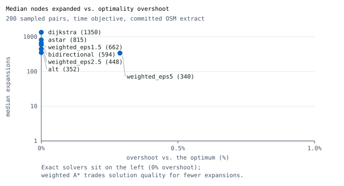

# Entrega Clara

**Pathfinding under real constraints, framed as a São Paulo food-delivery platform.** A college
brute-force route optimizer becomes unusable at about ten stops; this repository keeps it as the
baseline and answers it with a measured solver ladder running on **real OpenStreetMap streets** —
then wires that ladder into a delivery product where the courier actually drives the computed route,
batches orders under pickup-before-dropoff precedence, and the customer watches it happen.


*One delivery route in central São Paulo, searched twice. ALT landmarks finish in 70 expansions;
Dijkstra needs 167. The frame is drawn and encoded by `scripts/media/render_search_gif.py` with
nothing but the Python standard library — no image or charting dependency anywhere.*

## The measured ladder

Two families, one harness, one graph — `docs/benchmarks/routing.md` regenerates all of this with
`python scripts/bench/routing_benchmark.py`:

| Point-to-point (200 sampled pairs, time objective) | Median nodes expanded | Share of graph | Guarantee |
| --- | --- | --- | --- |
| Dijkstra (oracle) | 1 350 | 56.1% | exact |
| A* (straight line) | 815 | 33.9% | exact |
| **A* + ALT landmarks** | **352** | **14.6%** | exact (~37 ms preprocessing) |
| Bidirectional + ALT | 594 | 24.7% | exact |
| Weighted A* (ε = 1.5) | 662 | 27.6% | ≤ ε × optimal (max 0.26% over) |

| Multi-stop tour on the same street costs | 7 stops | 9 stops | 13 stops |
| --- | --- | --- | --- |
| Brute force (baseline) | 720 evals | 40 320 evals | infeasible |
| **Held-Karp (exact, precedence-aware)** | **486 evals · 1 368 s** | **3 592 evals · 1 900 s** | **135 180 evals · 2 014 s** |
| Nearest neighbor (fast guess) | 21 evals · +28% cost | 36 evals · +8% | 78 evals · +8% |
| 2-opt | 36 evals | 92 evals | 144 evals |

A 7-stop courier batch costs **~18 ms end to end** on the committed extract (matrix 17.4 ms + exact
tour 0.2 ms, median of three runs — wall times vary with the machine, and the artifact records its
own context), and the exact tour saves 18% of the driving time against nearest-neighbor on the same
matrix — that is the number the courier console shows.



Why landmarks rather than a bigger straight line: central São Paulo is one-way-dominant (76% of the
ways in the extract), so the straight-line bound is weak and the KPI that matters is whether the
search understands the network, not how fast it computes a hypotenuse. The full reasoning, including
why contraction hierarchies were rejected at this scale, is [ADR 0008](docs/adr/0008-real-street-graph-and-landmarks.md).

## Para recrutadores (iFood)

Este repositório demonstra, de ponta a ponta e sem dependências externas, o mesmo recorte operacional
que um app de delivery resolve em produção: cardápio → sacola → checkout idempotente → fila do
restaurante → oferta, coleta, rota e entrega do entregador → rastreamento por SSE → visão de
operações.

- **Roteirização de verdade**: grafo real do OpenStreetMap do centro de SP (2 405 nós, filtrado para
  o maior componente fortemente conexo, porque ruas de mão única dominam), com A\*, ALT, bidirecional
  e Held-Karp comparáveis na página `/lab` e em `docs/benchmarks/`.
- **Domínio real, não mock**: os mesmos handlers de comando atendem a API, as telas de papel e o
  cenário guiado (`data/scenarios/lunch-rush.json`).
- **Invariantes de negócio**: transições de estado válidas, um restaurante por sacola, cupom com
  validade/mínimo, uma entrega (ou lote) ativa por entregador, GPS monotônico, autorização por
  identidade resolvida no servidor.
- **Arquitetura substituível**: portas de aplicação (UoW, pagamento, roteirização, identidade,
  eventos) isolam os adapters; PostgreSQL, MapLibre/MapTiler, provedores de pagamento e autenticação
  real são expansões documentadas, não requisitos.
- **Qualidade verificável**: 216 testes de backend, 19 de frontend e 4 jornadas Playwright com
  varreduras de acessibilidade — contagens exatas em [docs/verification.md](docs/verification.md).
- **Brasil de verdade**: pt-BR, BRL em centavos, PIX, seed de São Paulo, cópia consciente de LGPD.

## Origem / Origin

**pt-BR** — Em outubro de 2026, uma aula de Análise e Desenvolvimento de Sistemas apresentou um
algoritmo de força bruta para roteirização: testar todas as ordens de visita. Ele funciona até cerca
de dez paradas e morre na décima primeira. Este repositório é a continuação desse exercício —
`LegacyBruteForceTSPSolver` continua no código como baseline e
[o gráfico de benchmarks](docs/benchmarks/routing.md) mostra, com números medidos, o que o substitui.

**English** — In October 2026 an undergraduate class introduced brute-force route optimization: try
every visit order. It works up to about ten stops and dies at eleven. This repository is that
exercise's follow-up — `LegacyBruteForceTSPSolver` stays in the code as the baseline and
[the benchmark table](docs/benchmarks/routing.md) measures what replaces it.

## Built vs. deferred

| Built | Deferred (documented, not required to run) |
| --- | --- |
| Solver ladder: brute force → nearest neighbor → 2-opt → Held-Karp (precedence), and Dijkstra → A\* → ALT → bidirectional → weighted ε-A\* | Contraction hierarchies; time windows and vehicle capacity; dynamic mid-route re-optimization |
| Real OSM street graph, ODbL, filtered to a strongly connected component | Real traffic data and provider routing (OSRM) |
| Batch dispatch: cost matrix, exact tour, stop-sequence console, Held-Karp vs nearest-neighbor line | Same-restaurant-only batching (deliberately broader — [ADR 0007](docs/adr/0007-multi-stop-batching.md)) |
| Customer → restaurant → courier → operations loop over real commands, SSE tracking, GPS that follows the route | PostgreSQL adapter (`PERSISTENCE_MODE=postgres` fails fast by design) |
| Operations timeline with ETA vs actual, demo replay, JSON snapshot export/import | Real payments, real identity, push/SMS/email, durable outbox/workers |
| Dependency-free search replay renderer and committed screenshots/charts | Hosting: everything runs locally with Python and Node only |

| Cliente | Restaurante | Entregador | Operações | Laboratório |
| --- | --- | --- | --- | --- |
|  |  |  |  |  |

## Primary demo story

Two stories share one code path. Interactively, each role page drives real commands: the customer
builds a cart and checks out (idempotent, simulated payment), the restaurant confirms/prepares/marks
ready, the courier accepts an offer or a 2–3 order batch, picks up, starts the graph-computed route,
streams GPS points that follow it, and completes each delivery — while the customer watches a live
SSE stream and map. The guided lunch-rush scenario replays the same journey, including the batch,
step-by-step through those same handlers via Demo Mode, with scoped reset that preserves dynamically
created orders.

## Market boundary

Brazil is the default market: `pt-BR`, BRL, PIX, cards, wallets, Brazilian seed geography, and
LGPD-aware privacy copy. It is not a Brazil-only design: locale, currency, payment methods,
addresses, time zones, legal copy, maps, and notifications remain configuration-driven for future
markets. Money uses integer minor units plus currency; time is stored canonically and rendered in
the active market time zone.

## Repository layout

| Path | Purpose |
| --- | --- |
| `app/backend/` | FastAPI surface, domain entities/state machine, application commands, memory adapters, routing solvers |
| `app/web/` | pt-BR role surfaces (cliente, restaurante, entregador, operações), canvas algorithm lab, SSE client, deterministic map |
| `data/seed/` | Deterministic Brazil reference seed (synthetic, no real personal data) |
| `data/graph/` | Street graphs: `sao-paulo-centro-osm.json` (real OSM extract, product and lab) and `sao-paulo-centro.json` (synthetic fixture and offline fallback) |
| `data/scenarios/` | Command-script demo scenarios replayed through real handlers |
| `docs/` | Architecture, ADRs, requirements traceability, runbooks, benchmarks, and media |
| `scripts/` | Development, demo, validation, benchmark, media, and quality automation |
| `tests/` | Backend, frontend, repository, and e2e test suites |

All application source belongs under `app/`.

## Demo access

The local web shell provides working surfaces for Customer (`/customer`), Restaurant
(`/restaurant`), Courier (`/courier`), Operations (`/admin`), the algorithm lab (`/lab`), and the
guided scenario at `/demo`. Each surface sends a fixed `X-Demo-Identity` header resolved server-side
— a demo aid, never real authentication.

## Local setup

Requires only Python 3.11+ and Node 22+ — no Docker, database, `make`, or provider accounts.

1. Copy `.env.example` to `.env` (optional; safe defaults, no credentials needed).
2. Install dependencies:

   ```bash
   python -m pip install -e "app/backend[dev]"
   cd app/web && npm install
   ```

3. Start the API from the repository root:

   ```bash
   uvicorn delivery_platform.api.main:app --port 8000
   ```

4. Start the web shell in a second terminal:

   ```bash
   cd app/web && npm run dev
   ```

5. Open `http://localhost:3000`; the API listens on `http://localhost:8000` (`GET /api/v1/health`).

Docker Compose, PostgreSQL, MapTiler, and external providers are documented future expansions, not
requirements — see [external dependencies](docs/architecture/external-dependencies.md).

See the [local development runbook](docs/runbooks/local-development.md) for local URLs and service
details, and the [demo-mode runbook](docs/runbooks/demo-mode.md) for deterministic reset,
advancement, replay, and role-navigation instructions.

## Commands

Run from the repository root (the Makefile wraps the same commands when `make` is available):

| Command | Purpose |
| --- | --- |
| `python -m pytest tests -q` | Backend and repository tests |
| `cd app/web && npm test -- --run` | Frontend tests |
| `ruff check app/backend/src tests scripts` | Backend lint |
| `mypy app/backend/src` | Backend type check |
| `cd app/web && npm run lint` / `typecheck` | Frontend lint and type check |
| `python scripts/check.py` | Full local gate (fast mode: `--fast`, browser journeys: `--e2e`) |
| `python scripts/bench/routing_benchmark.py` | Regenerate the benchmark artifacts (`--smoke` for CI, `--export-lab-trace` for the replay) |
| `python scripts/media/render_search_gif.py` | Render the search replay GIF from the committed trace |
| `python scripts/dev.py` | Start API and web shell together |
| `python scripts/data/validate_seed.py data/scenarios/lunch-rush.json` | Validate the deterministic scenario |
| `python scripts/quality/check_requirement_coverage.py docs/requirements/traceability.md` | Requirement coverage |
| `python scripts/repo/check_app_boundary.py` | Application source boundary |
| `python scripts/demo/reset_demo.py` | Reset the running local API scenario |
| `cd app/web && npx playwright test` | Browser journeys, screenshots, and axe scans |

## Data attribution

The street graph is derived from OpenStreetMap data:
**© OpenStreetMap contributors, [ODbL 1.0](https://www.openstreetmap.org/copyright)**. It is fetched
offline by `scripts/data/fetch_osm_graph.py`, committed as a dated snapshot
(`version: osm-<date>`), and never queried at run time. The synthetic graph carries no external
data.

## Release and publication status

The project is public at [FishRaposo/entrega-clara](https://github.com/FishRaposo/entrega-clara). It
remains a non-production demo platform: follow the
[public demo release runbook](docs/runbooks/public-demo-release.md) to reproduce local validation,
and record any Docker-unavailable check as unverified rather than passed.

Clone it with:

```bash
git clone https://github.com/FishRaposo/entrega-clara.git
```

## Non-production limitations

This is not a production payment platform, logistics company, or identity provider. The current
runtime uses seeded or simulated payment references, roles, GPS updates, notifications, and
operational data. It must not process real funds, customer card data, production credentials, real
courier identity verification, or live support operations.

The street graph is an OpenStreetMap snapshot of one central São Paulo district, filtered to its
largest strongly connected component: distances and ETAs are plausible, not navigational, and change
whenever the extract is regenerated. ETA accuracy claims are about the simulated demo clock, not
about real traffic.

The governing product specification is
[the seed design](docs/superpowers/specs/2026-08-29-food-delivery-platform-seed-design.md).
