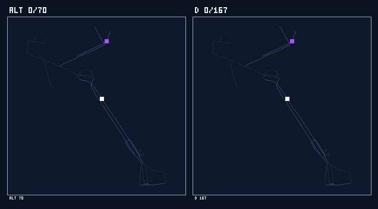
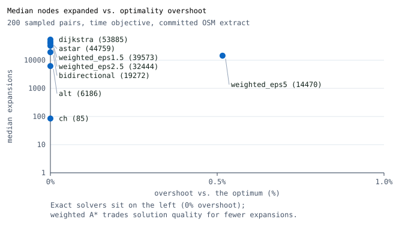
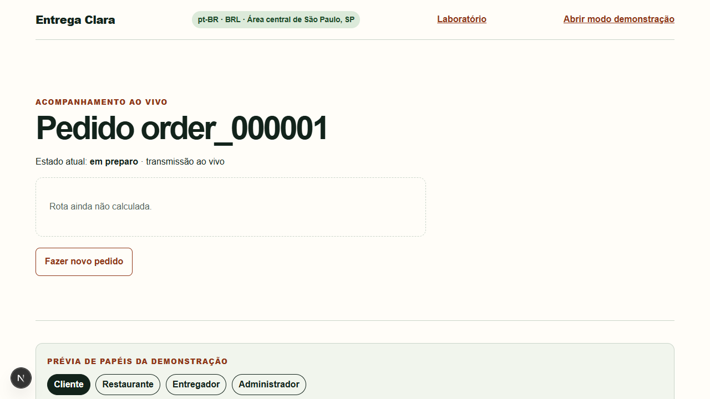
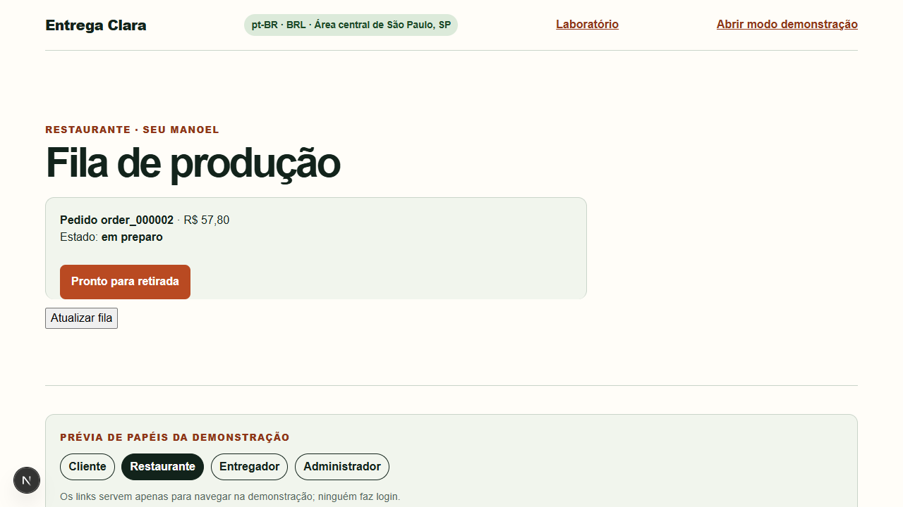
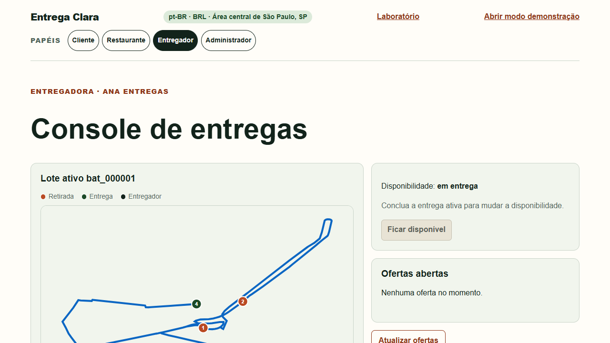
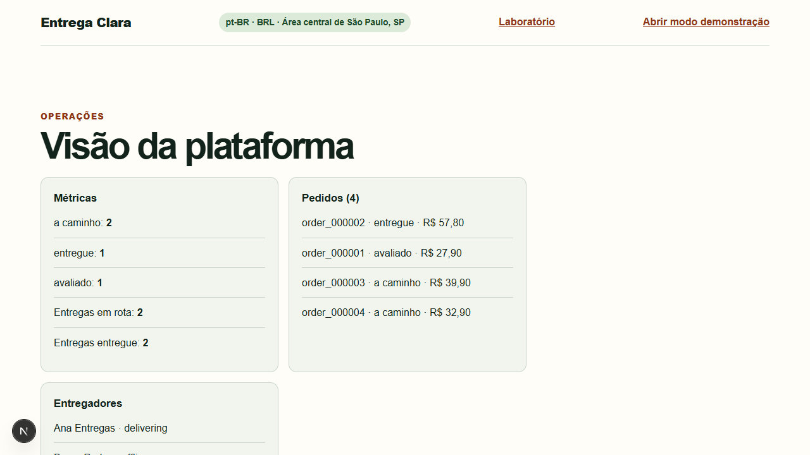
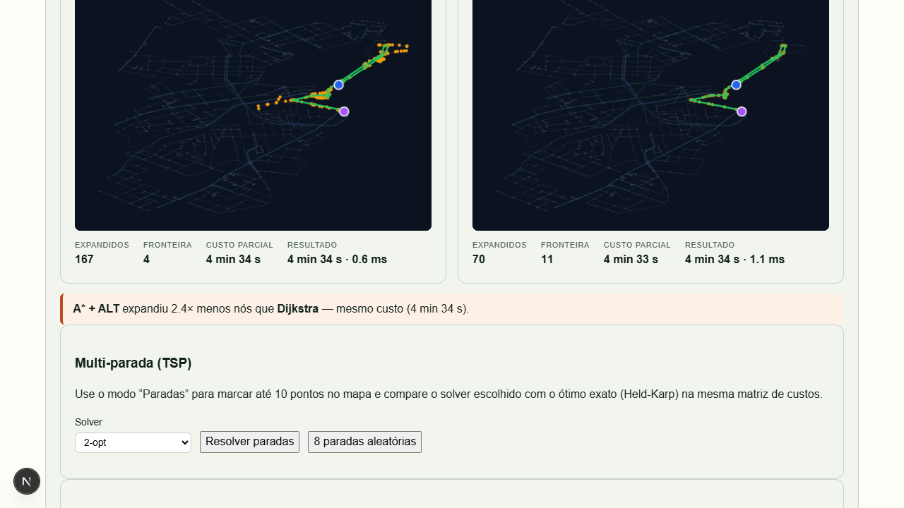

# Entrega Clara

[](https://github.com/FishRaposo/entrega-clara/actions/workflows/ci.yml)

**Pathfinding under real constraints, framed as a São Paulo food-delivery platform.** It began as two
undergraduate assignments — a food-delivery requirements document and a brute-force route optimizer —
that turned out to describe one system. The optimizer still dies at about ten stops; this repository
keeps it as the baseline and answers it with a measured solver ladder on **real OpenStreetMap
streets**, wired into a delivery product where the courier drives the computed route, batches orders
under pickup-before-dropoff precedence, and the customer watches it happen.



*One delivery route in central São Paulo, searched twice. ALT landmarks finish in 70 expansions;
Dijkstra needs 167. The frame is drawn and encoded by `scripts/media/render_search_gif.py` with
nothing but the Python standard library — no image or charting dependency anywhere.*

## At a glance

| | |
| --- | --- |
| **What it is** | A São Paulo food-delivery platform where the courier drives the computed route. Built from two undergraduate assignments — a requirements document and a brute-force route optimizer — merged into one product. |
| **What it proves** | A measured solver ladder on real streets: **CH answers in 85 expansions (0.1% of the graph) / 2.8 ms** where Dijkstra needs 53,885 (51.3%) / 172 ms, inside a product with batching, capacity, promised windows, time-dependent ETAs and a PostgreSQL option. |
| **Engineering** | Python/FastAPI + Next.js/TypeScript; 291 backend tests (296 with the database contract), 19 frontend, 3 browser journeys with axe; 12 ADRs; 11 quality gates. |
| **See it without running it** | [Live lab](https://fishraposo.github.io/entrega-clara/) · [Static lab](site/index.html) (offline replay, no server) · [35-second tour](docs/media/demo-tour.webm) · [screenshots](#see-it-without-running-it) |
| **Review it** | [Reviewing this repository](docs/for-reviewers.md) — five-minute path, role-specific paths, what is real vs simulated, and where each claim is proven. |

No Docker, database, `make` or provider accounts are required for the default run.

## The measured ladder

One harness, two real graphs — `docs/benchmarks/routing-city.md` (104,991 nodes) and
`docs/benchmarks/routing.md` (2,405 nodes) regenerate everything with
`python scripts/bench/routing_benchmark.py --graph city|centro`:

| Point-to-point, city graph (200 sampled pairs, time objective) | Median nodes expanded | Share of graph | Median time |
| --- | --- | --- | --- |
| Dijkstra (oracle) | 53,885 | 51.3% | 172.1 ms |
| A* (straight line) | 44,759 | 42.6% | 225.5 ms |
| ALT landmarks (8) | 6,186 | 5.9% | 95.4 ms |
| Bidirectional + ALT | 19,272 | 18.4% | 593.9 ms |
| **Contraction hierarchy** | **85** | **0.1%** | **2.82 ms** |
| Weighted A* (ε = 5) | 14,470 | 13.8% | 86.3 ms (max 13% over) |

Expansions and shares are stable across runs; times are medians from the committed 2026-11-01 run
and vary with the machine. The artifact is the source of truth.

CH pays a one-time **2.7 s** build (138 MB peak, 164,517 shortcuts from 3-hop witness searches) and
then **breaks even after 12 queries against A\* and 29 against ALT**. That break-even is the whole
selection thesis: a dispatcher answering thousands of routes amortizes it instantly, a single route
per process never does — see the [solver selection guide](docs/architecture/solver-selection.md).

| Multi-stop tour on city street costs | 7 stops | 9 stops | 13 stops |
| --- | --- | --- | --- |
| Brute force (baseline) | 720 evals | 40,320 evals | infeasible |
| **Held-Karp (exact, precedence-aware)** | **486 evals · 8,547 s** | **3,592 evals · 16,776 s** | **135,180 evals · 19,545 s** |
| Nearest neighbor (fast guess, % over exact) | 21 evals · +37% cost | 36 evals · +8% | 78 evals · +22% |
| 2-opt | 51 evals | 148 evals | 276 evals |

Two honest readings of the same artifacts: the straight-line A\* expands 17% fewer nodes than
Dijkstra yet takes 31% longer in wall time (the heuristic costs more than it saves on one-way
streets), and pricing a 7-stop batch matrix at city scale costs **~2.7 s** (one-to-all Dijkstra per
stop) — a real bound on dispatch that the guide names instead of hiding.

The centro graph stays as the product and lab graph: 2,405 nodes, 0.7 MB, millisecond-scale routes and
browser-renderable. Its numbers are in `docs/benchmarks/routing.md`.



Why landmarks rather than a bigger straight line: central São Paulo is one-way-dominant (76% of the
ways in the extract), so the straight-line bound is weak and the KPI that matters is whether the
search understands the network, not how fast it computes a hypotenuse. That reasoning is
[ADR 0008](docs/adr/0008-real-street-graph-and-landmarks.md); the city graph and contraction
hierarchies it deferred are [ADR 0009](docs/adr/0009-city-scale-graph-and-contraction-hierarchies.md).

## For freelance clients

**Problem:** a delivery operation needs routes that respect capacity, promised windows and
pickup-before-dropoff, without standing up a fragile infrastructure stack first.
**Scope:** a working reference platform — memory mode by default, PostgreSQL optional, measured
routing and dispatch, tests and runbooks; not a production service.
**Outcome:** a dispatcher can price a seven-stop city batch in ~2.7 s, answer a city route in 85
expansions ([city benchmark](docs/benchmarks/routing-city.md)), and inspect the whole loop without
Docker or a database.
**Handover:** [reviewer path](docs/for-reviewers.md), [verification record](docs/verification.md),
and the run section below.

## Para recrutadores (iFood)

Uma observação de cronologia, porque ela importa: este projeto não foi construído para o iFood. Ele
nasceu de dois trabalhos de faculdade e virou peça de portfólio antes deste processo seletivo; a
afinidade com o domínio de delivery foi uma coincidência que o tornou especialmente relevante — e não
o contrário. [A história completa está em docs/origin.md](docs/origin.md).

Este repositório demonstra, de ponta a ponta e sem dependências externas obrigatórias, o mesmo recorte
operacional que um app de delivery resolve em produção: cardápio → sacola → checkout idempotente →
fila do restaurante → oferta, coleta, rota e entrega do entregador → rastreamento por SSE → visão de
operações.

- **Roteirização de verdade**: grafo real do OpenStreetMap do centro de SP (2,405 nós, filtrado para
  o maior componente fortemente conexo, porque ruas de mão única dominam), com A\*, ALT, bidirecional
  e Held-Karp comparáveis na página `/lab` e em `docs/benchmarks/`.
- **Domínio real, não mock**: os mesmos handlers de comando atendem a API, as telas de papel e o
  cenário guiado (`data/scenarios/lunch-rush.json`).
- **Invariantes de negócio**: transições de estado válidas, um restaurante por sacola, cupom com
  validade/mínimo, uma entrega (ou lote) ativa por entregador, GPS monotônico, autorização por
  identidade resolvida no servidor.
- **Arquitetura substituível**: portas de aplicação (UoW, pagamento, roteirização, identidade,
  eventos) isolam os adapters; PostgreSQL é opcional e implementado, e MapLibre/MapTiler, provedores
  de pagamento e autenticação real seguem como expansões documentadas — nunca requisitos.
- **Qualidade verificável**: 291 testes de backend (296 com o contrato PostgreSQL ativo), 19 de
  frontend e 3 jornadas Playwright com varreduras de acessibilidade — contagens exatas em
  [docs/verification.md](docs/verification.md).
- **Brasil de verdade**: pt-BR, BRL em centavos, PIX, seed de São Paulo, cópia consciente de LGPD.

## Origem / Origin

**pt-BR** — O projeto começou como dois trabalhos de faculdade: um documento de requisitos de um app
de delivery e um exercício de otimização de rotas por força bruta. Eles descreviam metades do mesmo
sistema, então a decisão foi implementar o sistema. A força bruta (`LegacyBruteForceTSPSolver`) ficou
no código como baseline e oráculo de corretude — e virou o roteador legado da empresa fictícia,
substituído com justificativa documentada. Depois o projeto virou peça de portfólio: complementa o
trabalho de IA aplicada com engenharia convencional — domínio, transações, algoritmos e trade-offs —
e roda sem exigir Docker, WSL ou banco (PostgreSQL é opcional).
[História completa em docs/origin.md](docs/origin.md), inclusive por que o iFood veio depois.

**English** — The project began as two undergraduate assignments: a food-delivery requirements
document and a brute-force route optimizer. They described two halves of one system, so the decision
was to build the system. The brute force (`LegacyBruteForceTSPSolver`) stayed as the baseline and the
correctness oracle — and became the fictional company's first router, replaced with a documented
rationale. It then became a portfolio piece: conventional engineering (domain, transactions,
algorithms, trade-offs) that complements applied-AI work, and a default run that needs no Docker, WSL
or database (PostgreSQL is optional). [The full story is in docs/origin.md](docs/origin.md),
including why iFood came afterwards.

**How it was built** — AI-assisted development with Command Code; every change is reviewed, tested
and gated by `scripts/check.py`, commits carry co-author trailers, and the benchmark artifacts are
generated by the committed harness rather than written by hand.
[The full policy is in docs/origin.md](docs/origin.md#8-how-it-was-built).

## Built vs. deferred

| Built | Deferred (documented, not required to run) |
| --- | --- |
| Solver ladder: Dijkstra → A\* → ALT → bidirectional → weighted ε-A\*, plus **contraction hierarchies** on a 105k-node city graph with a published break-even | Real traffic feeds and provider routing (OSRM); class-accurate traffic profiles (the graph stores speed, not highway class) |
| **Time-dependent routing** from a committed, FIFO-validated speed profile: ETAs and routes change by hour, and plans record departure/arrival | Real payments, real identity, push/SMS/email |
| **Capacitated VRP with promised windows** and **dynamic re-insertion** of a new order into an active batch, with typed rejection and a recorded ETA delta | Multi-process writes: the PostgreSQL adapter is single-writer (row-per-aggregate is the next step) |
| Real OSM street graphs (centro + city scale), ODbL, filtered to a strongly connected component | API/web hosting: the static lab is live on Pages; the API and web shell have deploy artifacts but are not deployed by CI |
| Batch dispatch: cost matrix, exact tour, stop-sequence console, offered-order baseline, capacity/waiting on screen | Same-restaurant-only batching (deliberately broader — [ADR 0007](docs/adr/0007-multi-stop-batching.md)) |
| Customer → restaurant → courier → operations loop over real commands, SSE tracking, GPS that follows the route | |
| **PostgreSQL adapter + transactional outbox worker** (`PERSISTENCE_MODE=postgres`, optional extra) and `/metrics` Prometheus text + operations panel | |
| Operations timeline with ETA vs actual, demo replay, JSON snapshot export/import | |
| **Static lab** (self-contained replay, zero network), committed benchmarks, screenshots, replay GIF and a recorded tour | |

| Cliente | Restaurante | Entregador | Operações | Laboratório |
| --- | --- | --- | --- | --- |
|  |  |  |  |  |

## See it without running it

- **Live lab**: [fishraposo.github.io/entrega-clara](https://fishraposo.github.io/entrega-clara/) is
  the same self-contained page served by GitHub Pages and published by `.github/workflows/pages.yml`.
  It replays committed traces (Dijkstra 167 expansions vs A\*+ALT 70), draws the day-long ETA curve
  from the committed traffic profile and prints the published TSP table.
- **Offline copy**: [`site/index.html`](site/index.html) — open it in a browser, no server and no
  network.
- **Recorded tour** (35 s, 2.3 MB): [`docs/media/demo-tour.webm`](docs/media/demo-tour.webm) — demo
  scenario, courier console with planned stops and capacity, customer tracking, lab race.
- [`docs/media/static-lab.png`](docs/media/static-lab.png) is the page's poster frame.

## Primary demo story

Two stories share one code path. Interactively, each role page drives real commands: the customer
builds a cart and checks out (idempotent, simulated payment), the restaurant confirms/prepares/marks
ready, the courier accepts an offer or a 2–3 order batch, picks up, starts the graph-computed route,
streams GPS points that follow it, and completes each delivery — while the customer watches a live
SSE stream and map. The guided lunch-rush scenario replays the same journey, including the batch,
step-by-step through those same handlers via Demo Mode, with scoped reset that preserves dynamically
created orders.

## Market boundary

Brazil is the default market: `pt-BR`, BRL, PIX, cards, wallets, Brazilian seed geography, and
LGPD-aware privacy copy. It is not a Brazil-only design: locale, currency, payment methods,
addresses, time zones, legal copy, maps, and notifications remain configuration-driven for future
markets. Money uses integer minor units plus currency; time is stored canonically and rendered in
the active market time zone.

## Repository layout

| Path | Purpose |
| --- | --- |
| `app/backend/` | FastAPI surface, domain entities/state machine, application commands, memory and optional PostgreSQL adapters, routing solvers |
| `app/web/` | pt-BR role surfaces (cliente, restaurante, entregador, operações), canvas algorithm lab, SSE client, deterministic map |
| `data/seed/` | Deterministic Brazil reference seed (synthetic, no real personal data) |
| `data/graph/` | Street graphs (`sao-paulo-centro-osm.json` for the product and lab, `sao-paulo-city.json.gz` at city scale, `sao-paulo-centro.json` as the synthetic fixture) and the committed traffic profile |
| `data/scenarios/` | Command-script demo scenarios replayed through real handlers |
| `docs/` | Architecture, ADRs, requirements traceability, runbooks, benchmarks, and media |
| `site/` | Generated self-contained static lab (GitHub Pages artifact, rebuilt by `scripts/media/export_static_lab.py`) |
| `scripts/` | Development, demo, validation, benchmark, media, worker, and quality automation |
| `tests/` | Backend, frontend, repository, and e2e test suites |

All application source belongs under `app/`.

## Demo access

The local web shell provides working surfaces for Customer (`/customer`), Restaurant
(`/restaurant`), Courier (`/courier`), Operations (`/admin`), the algorithm lab (`/lab`), and the
guided scenario at `/demo`. Each surface sends a fixed `X-Demo-Identity` header resolved server-side
— a demo aid, never real authentication.

## Local setup

Requires only Python 3.11+ and Node 22+ for the default memory mode — no Docker, database, `make`,
or provider accounts.

1. Copy `.env.example` to `.env` (optional; safe defaults, no credentials needed).
2. Install dependencies:

   ```bash
   python -m pip install -e "app/backend[dev]"
   cd app/web && npm install
   ```

3. Start the API from the repository root:

   ```bash
   uvicorn delivery_platform.api.main:app --port 8000
   ```

4. Start the web shell in a second terminal:

   ```bash
   cd app/web && npm run dev
   ```

5. Open `http://localhost:3000`; the API listens on `http://localhost:8000` (`GET /api/v1/health`).

Docker Compose, PostgreSQL and MapTiler are optional: memory mode needs none of them. The PostgreSQL
adapter is implemented behind the `[postgres]` extra; see
[external dependencies](docs/architecture/external-dependencies.md) and the
[PostgreSQL runbook](docs/runbooks/postgres.md).

See the [local development runbook](docs/runbooks/local-development.md) for local URLs and service
details, and the [demo-mode runbook](docs/runbooks/demo-mode.md) for deterministic reset,
advancement, replay, and role-navigation instructions.

## Commands

Run from the repository root (the Makefile wraps the same commands when `make` is available):

| Command | Purpose |
| --- | --- |
| `python -m pytest tests -q` | Backend and repository tests |
| `cd app/web && npm test -- --run` | Frontend tests |
| `ruff check app/backend/src tests scripts` | Backend lint |
| `mypy app/backend/src` | Backend type check |
| `cd app/web && npm run lint` / `typecheck` | Frontend lint and type check |
| `python scripts/check.py` | Full local gate (fast mode: `--fast`, browser journeys: `--e2e`) |
| `python scripts/bench/routing_benchmark.py` | Regenerate the benchmark artifacts (`--smoke` for CI, `--export-lab-trace` for the replay) |
| `python scripts/media/render_search_gif.py` | Render the search replay GIF from the committed trace |
| `python scripts/media/export_static_lab.py` | Rebuild the self-contained static lab (`site/index.html`) |
| `DATABASE_URL=... python -m pytest tests/repo -q` | Persistence contract on memory + PostgreSQL |
| `python scripts/worker.py --once` | Drain the PostgreSQL outbox once |
| `python scripts/dev.py` | Start API and web shell together |
| `python scripts/data/validate_seed.py data/scenarios/lunch-rush.json` | Validate the deterministic scenario |
| `python scripts/quality/check_requirement_coverage.py docs/requirements/traceability.md` | Requirement coverage |
| `python scripts/repo/check_app_boundary.py` | Application source boundary |
| `python scripts/demo/reset_demo.py` | Reset the running local API scenario |
| `cd app/web && npx playwright test` | Browser journeys, screenshots, and axe scans |

## Data attribution

The street graph is derived from OpenStreetMap data:
**© OpenStreetMap contributors, [ODbL 1.0](https://www.openstreetmap.org/copyright)**. It is fetched
offline by `scripts/data/fetch_osm_graph.py`, committed as a dated snapshot
(`version: osm-<date>`), and never queried at run time. The synthetic graph carries no external
data. The code is [MIT licensed](LICENSE); the street data is ODbL.

## Release and publication status

The project is public at [FishRaposo/entrega-clara](https://github.com/FishRaposo/entrega-clara). It
remains a non-production demo platform: follow the
[public demo release runbook](docs/runbooks/public-demo-release.md) to reproduce local validation,
and record any Docker-unavailable check as unverified rather than passed.

The static lab is published by the `static lab` workflow to
[GitHub Pages](https://fishraposo.github.io/entrega-clara/). The API and web shell are not deployed
by CI; their artifacts are committed: `Dockerfile` + `fly.toml` (API) and `app/web/vercel.json`.
See [deploying the demo](docs/runbooks/deploy.md).

Clone it with:

```bash
git clone https://github.com/FishRaposo/entrega-clara.git
```

## Non-production limitations

This is not a production payment platform, logistics company, or identity provider. The current
runtime uses seeded or simulated payment references, roles, GPS updates, notifications, and
operational data. It must not process real funds, customer card data, production credentials, real
courier identity verification, or live support operations.

The street graph is an OpenStreetMap snapshot of one central São Paulo district (plus a
city-scale extract for benchmarks), filtered to its largest strongly connected component: distances
and ETAs are plausible, not navigational, and change whenever the extract is regenerated. The traffic
profile is synthetic and deterministic, and ETA accuracy claims are about the simulated demo clock,
not about real traffic.

Persistence: memory is the default and loses state on restart; the optional PostgreSQL adapter stores
a transactional snapshot with an outbox and is single-writer (ADR 0012). It is not a production
database claim — row-per-aggregate tables, migrations, backups and multi-writer support are not
built.

The governing product specification is
[the seed design](docs/superpowers/specs/2026-08-29-food-delivery-platform-seed-design.md).
