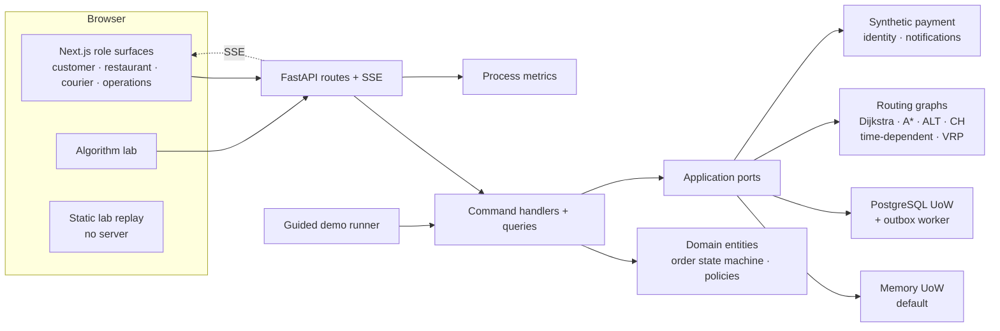

# System overview

A one-page map of the modular monolith. It is a reading aid, not a new contract: the
[system boundaries](system-boundaries.md) table and the [routing contract](routing-contract.md) are
authoritative, and [ADR 0001](../adr/0001-modular-monolith.md) records the shape.

The browser renders routes and maps; it never decides a business route. The static lab is a committed
replay with no server. Memory persistence is the default; the PostgreSQL adapter and outbox are
optional and sit behind the same ports.

## Where to look

| Path | What it shows |
| --- | --- |
| `application/commands/` | The one write path used by the API, role screens and guided demo; clock and IDs are injectable |
| `application/queries.py` | Read models for the role surfaces and operations view |
| `application/ports.py` | Unit-of-work, routing, payment, identity and event contracts |
| `domain/entities.py`, `domain/order_states.py` | Order and delivery state machine, invariants and errors |
| `routing/` | Graph loading, Dijkstra/A\*/ALT/CH, time-dependent search, matrices and VRP |
| `adapters/memory/`, `adapters/postgres/` | Default memory adapters and the optional transactional snapshot + outbox |
| `api/` | FastAPI routes, serializers, error mapping and SSE |
| `app/web/src/components/` | Role surfaces and the canvas algorithm lab |
| `site/index.html` | Generated static replay of the committed traces |

## Boundaries in one line each

- **One command layer:** HTTP routes, role pages and the demo run the same handlers; business rules do
  not live in routes or components.
- **Ports and adapters:** memory is the default; PostgreSQL, routing and simulated providers implement
  the same application contracts.
- **Routing on the backend:** the browser receives geometry; it does not call a provider to decide a
  business route.
- **Non-production by design:** payments, identity, GPS and notifications are simulated; the
  [non-production limitations](../verification.md#honest-scope-notes) are explicit.
